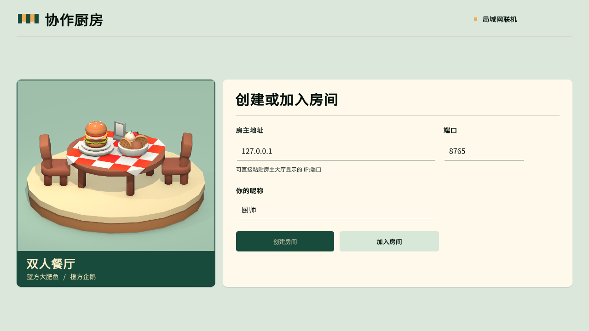
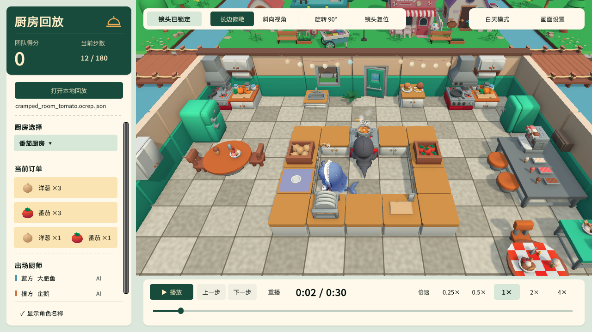
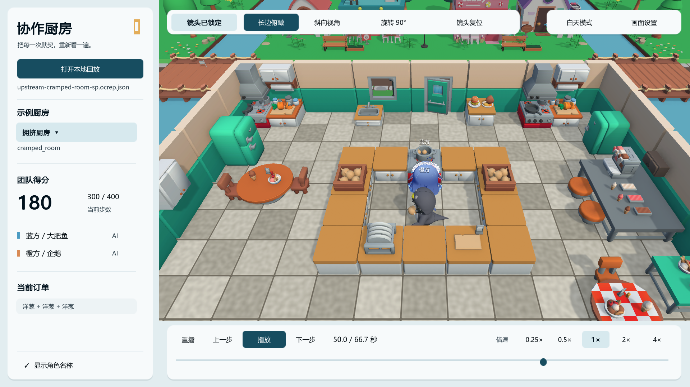
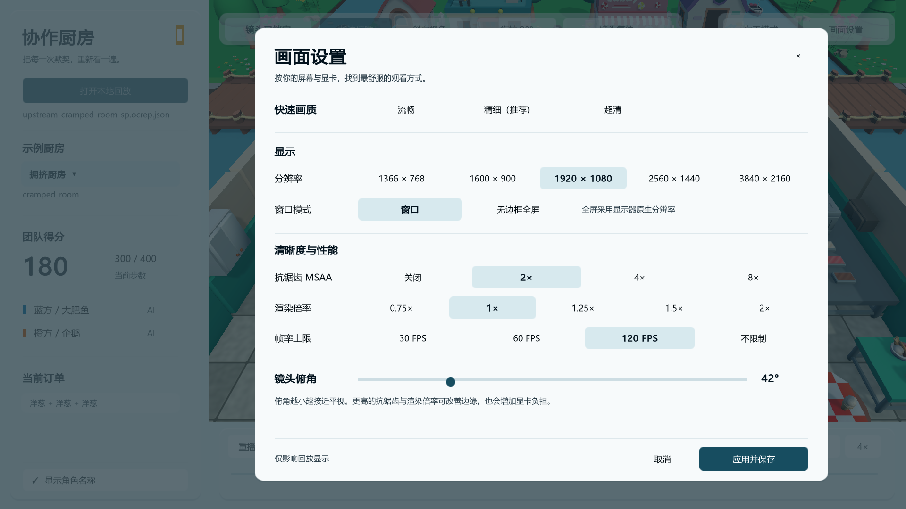

<div align="center">

<h1>Better replay frontend of overcook-ai</h1>

<p>把 Overcooked-AI 对局搬进 3D 厨房。回看智能体的配合，或在 Windows 上开房一起做菜。</p>

<p>
  <a href="https://github.com/LynxPeng/Better-replay-frontend-of-overcook-ai/releases/tag/v0.2.0-live-windows-preview"></a>
  <a href="https://github.com/LynxPeng/Better-replay-frontend-of-overcook-ai/releases/tag/v0.1.3-macos-preview"></a>
  <a href="LICENSE"></a>
</p>

</div>

[下载与快速开始](#下载与快速开始) · [实时联机](#实时联机) · [界面展示](#界面展示) · [怎样生成记录](#怎样生成记录) · [源码结构和重建](#源码结构和重建)

<a id="下载即用--windows-quick-start"></a>

## 下载与快速开始

| 用途 | 下载与启动 |
| --- | --- |
| **联机**<br>Windows | [x64 预览 v0.2.0][live-zip] · 约 356 MiB<br>打开 `OvercookedLive.exe` |
| **回放**<br>Windows | [x64 离线版 v0.1.0][win-zip] · 约 79 MiB<br>打开 `OvercookedReplay.exe` |
| **回放**<br>macOS | [Universal 预览 v0.1.3][mac-zip] · 约 98 MiB<br>打开 `OvercookedReplay.app` |

完整解压后从解压目录打开程序，保留同目录的配套文件。发行包已附运行库、美术和示例，联机包还附房主服务与 CPU 模型。各版本的校验文件与验收范围见 [Releases][releases]。

**第一次看回放**，展开左侧的厨房列表，选择 `upstream-sp-220`，再点「播放」。这是内置的上游自博弈对局，共 400 步、401 个状态帧，最终得分 220。观看自己的对局时，点「打开本地回放」，选择 `.ocrep.json`。

- **回放定位**可用空格播放或暂停、左右方向键逐步、时间轴跳转，以及 0.25× 至 4× 倍速。当前源码分支的金色刻度标记实际交付，便于对比前后状态与比分。
- **画面与镜头**可切换昼夜。解锁镜头后，滚轮缩放，Shift 加滚轮升降，WASD 或中键平移，右键拖动调整俯仰。[画面设置预览](#画面设置)
- **Windows 离线包**适用于 Windows 10/11 x64 与 Direct3D 11/12。[Windows 回放使用说明](WINDOWS-QUICKSTART.md)
- **macOS 预览**包含 Apple Silicon 和 Intel 双架构，并内置中文字体。v0.1.3 的实际 Metal 画面仍待 Mac 实机验收。[macOS 使用说明](MACOS-QUICKSTART.md)

## 实时联机

房主和来宾都打开 `OvercookedLive.exe`。房主点击「创建房间」，在大厅选模式，应用设置并准备，再点「开始对局」。[查看联机大厅](#联机大厅)

| 大厅模式 | 怎么用 |
| --- | --- |
| **人人联机** | 房主将大厅显示的 `IPv4:端口` 发给同一局域网的朋友。朋友在首页填入地址并点「加入房间」，双方准备后由房主开始。 |
| **人机合作** | 选择自己的席位，为另一名厨师选 Greedy、内置 PPO 或上游 SP。SP 预设使用拥挤厨房和旧烹饪规则。 |
| **机机观战** | 为两个席位分别选模型。两个席位可以各自运行同一个模型的独立实例。 |

WASD 或方向键移动，E 或空格交互，Esc 暂停。默认一局 400 步、每秒 2 步。结算后可点「回看本局」，对局记录保存在房主电脑。访客断线后有 30 秒恢复原席位。

便携包已在 Windows 解压验收。双人使用同机双客户端完成断线重连，人机使用包内 PPO，双 SP 跑完 400 步并得到 220 分。跨两台实体电脑的联机仍待实测。[便携版使用说明和录像位置](LIVE-PORTABLE-QUICKSTART.md) · [联机开发与验证](docs/LIVE_VALIDATION.md)

## 界面展示

### 联机大厅

Windows 便携联机版 v0.2.0 的首页。房主从这里创建房间，来宾可填写地址后加入。

[](docs/images/live-lobby.png)

### 回放与交付

白天的番茄厨房展示混合订单与台面提示。左侧列出所需洋葱和番茄，蓝色高亮标出厨师面前可交互的台面。

[](docs/images/replay-day.png)

夜间回放取自上游模型的 220 分对局。餐厅灯串亮起，底部时间轴的金色标记对应实际交付。

[](docs/images/main-final.png)

### 画面设置

在回放器右上角打开「画面设置」，可调整分辨率、抗锯齿、渲染倍率、帧率与镜头俯角。

[](docs/images/settings-final.png)

## 怎样生成记录

发行包可直接观看。下面的 Python 路径适合想把**自己的智能体或已有轨迹**接入播放器的人。准备 **Python 3.10** 和 **Git**，在本仓库根目录打开 PowerShell，执行以下命令。

```powershell
python -m venv .venv
.\.venv\Scripts\python.exe -m pip install -e .
.\.venv\Scripts\python.exe examples\record_episode.py
.\.venv\Scripts\python.exe -m better_overcooked_replay validate output\my-game.ocrep.json
```

示例用随机动作生成一场 400 步记录。在回放器中打开 `output/my-game.ocrep.json` 即可检查结果。[完整记录示例](examples/record_episode.py)

### 接入你自己的智能体

在初态创建 `ReplayRecorder`，让两名智能体基于**同一个状态**选择动作。每次联合动作只调用一次 `env.step()`，随后把动作、新状态、奖励和 `info` 写入记录器。保存最后一帧后再重置环境。完整对局包含 **T 步和 T+1 帧**，提前结束时用 `complete=False`。展示时间由 `tick_rate` 决定，团队得分使用稀疏奖励，塑形奖励单独保存。

### 转换旧轨迹或生成样例

支持上游标准轨迹字典 JSON/pickle、网页 demo 的 `result.pkl`、人类 CSV 与 pickled DataFrame。人类数据使用 `.[import]` 额外依赖。只导入来源可信的 pickle。已有上游环境可用 `pip install -e . --no-deps` 安装工具，但需要自行匹配依赖版本。

```powershell
# 在已有 rollouts.pkl 时转换。若采集时使用旧烹饪规则，将 new 改为 old
.\.venv\Scripts\python.exe -m better_overcooked_replay convert rollouts.pkl --out output\imported --dynamics new

# 从环境生成内置样例
.\.venv\Scripts\python.exe -m better_overcooked_replay samples --out output\samples
```

采集上游轨迹时，使用 `env.get_rollouts(agent_pair, num_games=1, final_state=True)` 保留终态。裸 `run_agents()` 输出需先整理成标准轨迹字典。

<details>
<summary>历史轨迹的缺帧、终态和事件</summary>

转换器保留已有时间戳，多局输入会拆成多个文件。缺帧作为间隔标记，末态只有在显式规则下验证过状态转移与奖励后才补算。验证失败时保留到最后已知状态，把未恢复的动作写入诊断。只有视频、RGB 图像或得分时，缺少重建 3D 对局所需的状态。

历史导入主要根据状态变化推断事件，交付音效和庆祝可能缺失。需要完整交互事件时，优先直接记录 `env.step()`。

</details>

## 特别说明：上游源码的一行补丁

Python 运行 [Overcooked-AI][upstream] 的规则并产生状态，Unity 用状态渲染人物、厨房和动画。工具依赖固定的上游提交 `739950a079cdaed5a44fcc662efc40244c205d06`，记录工具使用独立包 `better_overcooked_replay`。

如果希望记录器获得准确的拾取、入锅和交付事件，可选用 [事件透传补丁](patches/upstream-event-info.patch)。它在上游 `_prepare_info_dict` 中添加 `env_info["event_infos"] = mdp_infos["event_infos"]`，将 MDP 已计算的事件交给记录器。仅使用基础状态和得分时，可直接使用上游环境。事件缺失时，交付专属提示音和庆祝可能缺失。

在本仓库根目录用 PowerShell 执行，先把 `$upstream` 改为固定版本的上游检出目录。

```powershell
$upstream = "C:\path\to\overcooked_ai"
$patch = (Resolve-Path .\patches\upstream-event-info.patch).Path
git -C $upstream apply --check $patch
if ($LASTEXITCODE -eq 0) { git -C $upstream apply $patch }
```

## 源码结构和重建

| 目录 | 用途 |
| --- | --- |
| [`unity/OvercookedViewer/`](unity/OvercookedViewer) | Unity 场景、回放与联机界面、角色和构建入口 |
| [`src/better_overcooked_replay/`](src/better_overcooked_replay) | 记录协议、轨迹转换、联机房主与策略适配 |
| [`examples/`](examples) · [`tests/`](tests) | 接入示例和 Python 回归 |
| [`scripts/`](scripts) · [`docs/`](docs) | 构建、打包、验收和使用说明 |

重建需要 **Unity 6000.6.8f1、URP 17.6** 及本地美术资源。按 [资源说明](unity/ASSET_SOURCES.md) 导入 Restaurant Bits for Unity、Cartoon Town 和 Synty Simple Sky，保留资产的 `.meta` GUID。联机构建还需要本地角色预制体。准备好资源后，从本仓库根目录运行 Windows 构建。

```powershell
.\scripts\build-windows.ps1
```

输出为 `output/Windows/OvercookedReplay.exe`。首次生成场景和预制体时使用 `-Initialize`。已有场景和预制体时使用上面的命令，以保留工程编辑。

- **联机开发和便携包重建**见 [Windows 实时对局开发指南](LIVE-QUICKSTART.md)。
- **macOS 重建**在 Windows 的同版本 Unity 中安装 macOS Build Support (Mono)，运行 [`build-macos.ps1`](scripts/build-macos.ps1)，再用 [`package-macos.py`](scripts/package-macos.py) 打包 `output/macOS/OvercookedReplay.app`。[Mac 构建与验收](docs/MACOS_VALIDATION.md)
- **Python 回归**在 Python 3.10 环境安装 `.[test]` 后运行 `python -m pytest tests -q`。训练适配依赖列在 [`pyproject.toml`](pyproject.toml) 的 `train` 额外依赖中。

## 许可证与署名

这是面向 Overcooked-AI 的社区项目。源码采用 [MIT](LICENSE)，保留 Center for Human-Compatible AI 版权声明。角色、商店美术、字体和 Unity 运行库适用各自的许可。发行包内附 `CharacterCredits.txt`、第三方声明及许可证目录。[第三方声明](THIRD_PARTY_NOTICES.md) · [许可证文件](LICENSES)

[live-zip]: https://github.com/LynxPeng/Better-replay-frontend-of-overcook-ai/releases/download/v0.2.0-live-windows-preview/OvercookedLive-Windows-x64-v0.2.0-live-windows-preview.zip
[win-zip]: https://github.com/LynxPeng/Better-replay-frontend-of-overcook-ai/releases/download/v0.1.0/BetterReplay-Windows-x64-v0.1.0.zip
[mac-zip]: https://github.com/LynxPeng/Better-replay-frontend-of-overcook-ai/releases/download/v0.1.3-macos-preview/BetterReplay-macOS-Universal-v0.1.3-macos-preview.zip
[releases]: https://github.com/LynxPeng/Better-replay-frontend-of-overcook-ai/releases
[upstream]: https://github.com/HumanCompatibleAI/overcooked_ai
