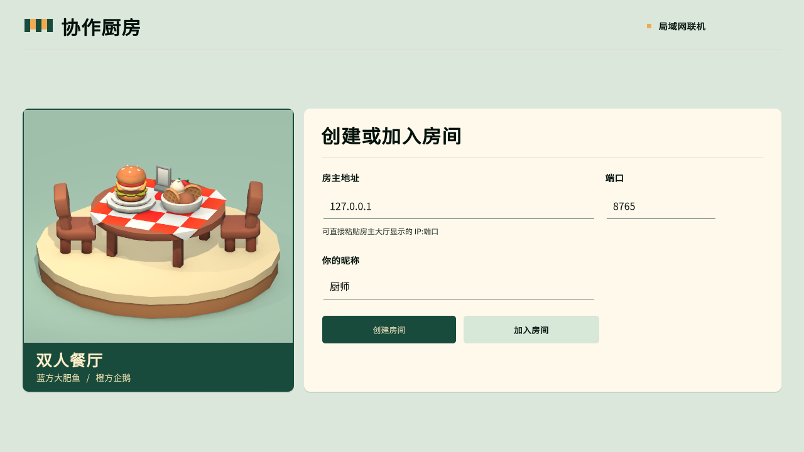
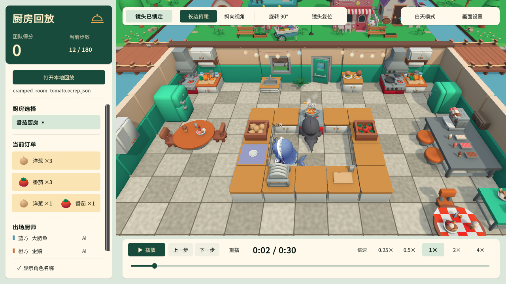
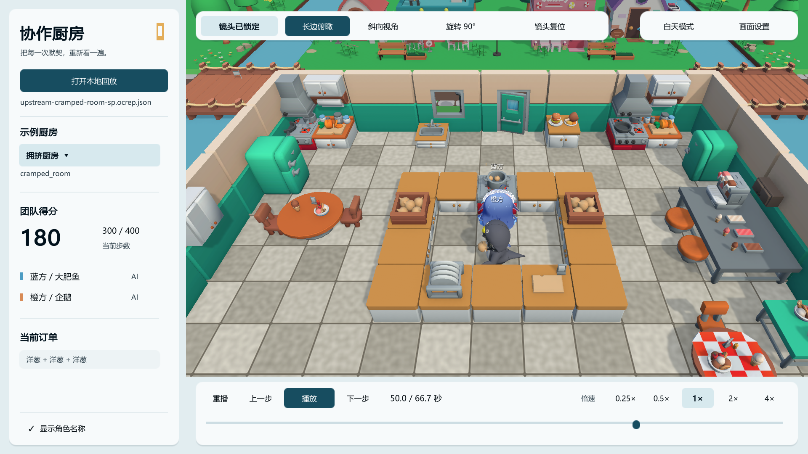
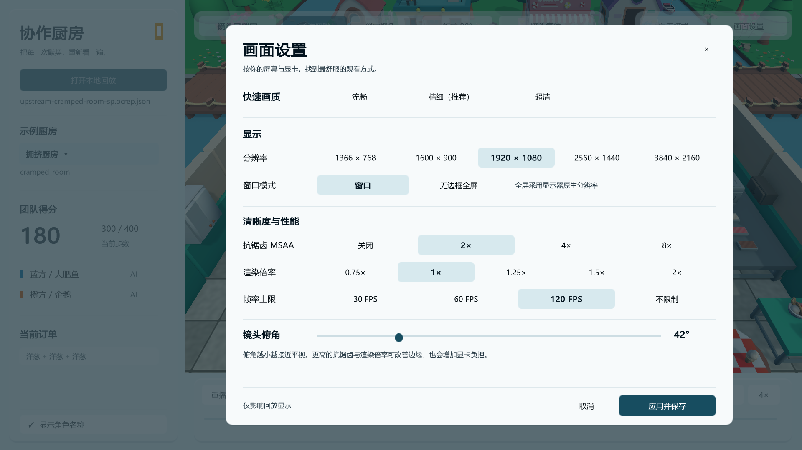

# 界面展示

[返回项目首页](../README.md) · [选择下载](../README.md#下载与快速开始) · [联机大厅](#联机大厅) · [回放与交付](#回放与交付) · [画面设置](#画面设置)

## 联机大厅

打开 Windows 便携联机版后，房主点「创建房间」。来宾填入房主地址和端口，再点「加入房间」。[联机操作](../LIVE-PORTABLE-QUICKSTART.md)

*截自 Windows 便携联机预览 v0.2.0。*

## 回放与交付

白天的番茄厨房展示了混合订单与台面提示。左侧能看到所需洋葱和番茄，画面中的高亮表示厨师面前可交互的台面。

夜间模式会压暗室外并点亮餐厅灯串。下图使用上游模型的 220 分完整示例，时间轴上的金色标记对应实际交付。

*白天和夜间画面均来自 Windows 构建。*

## 画面设置

从回放器右上角打开「画面设置」，可以调整分辨率、抗锯齿、渲染倍率、帧率与镜头俯角。

